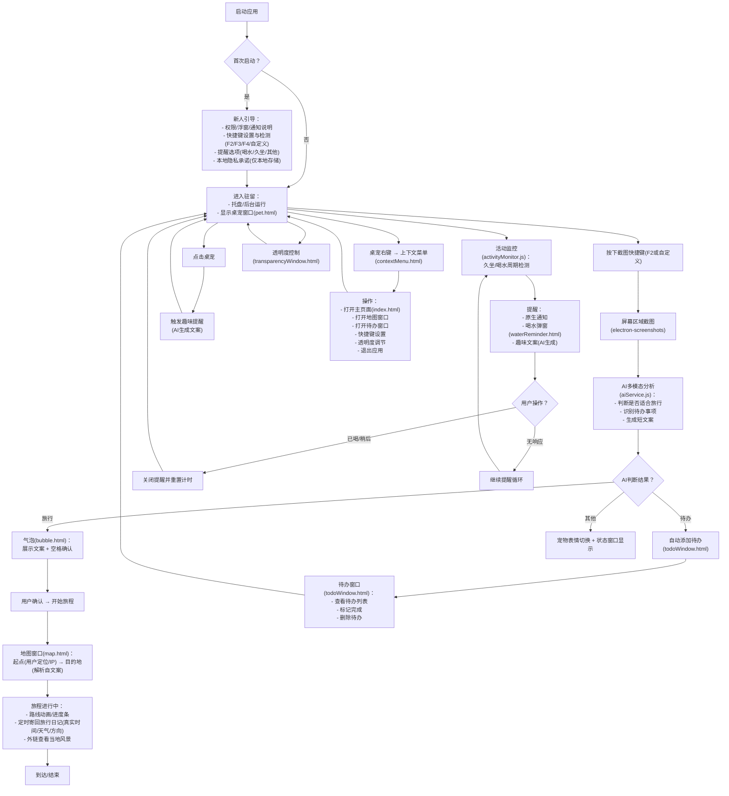
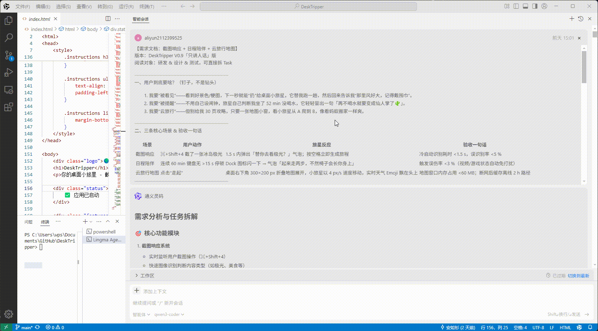
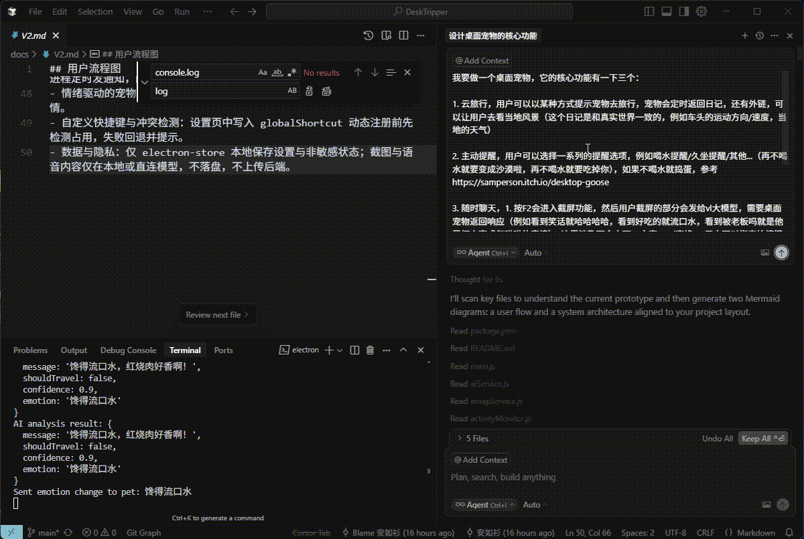

# HeiDeskCat：让小黑做你的上班搭子

> 内源平台讨论链接：[演示视频](<removed>)

如果你也相信 AI 不应该只有智商还应该有情商，或者单纯喜欢罗小黑一样可可爱爱的国漫 IP，请为我们点个 ⭐！

## 背景与用户洞察

1. **AI + 情绪陪伴的蓝海机会**  
   - 市面上 AI + 搜索/问答/工具 是红海，但 **AI + 情绪陪伴** 尚未被充分挖掘，参考[小红书独立开发大赛 2025](https://www.ifanr.com/1621805)。
   - [GPT-4o替代爹味GPT-5！奥特曼光速滑跪，OpenAI连夜回滚「赛博舔狗」](https://mp.weixin.qq.com/s/RXLQtu5MoPg4G82af4dVrg) - 用户反馈GPT-5情商不如4o，说明对"有情商"的AI陪伴类应用有强烈期待。  
   - 现有 AI 产品大多基于网页对话框（或语音接口），需要用户主动进入情境，缺乏 **桌面级、持续存在的视觉 AI 形态**。

2. **桌面宠物的空白**  
   - 虽有部分桌面宠物因"萌"出圈（如[捣蛋鹅](https://samperson.itch.io/desktop-goose)、[VPet](https://github.com/LorisYounger/VPet)、[Bongo Cat](https://mp.weixin.qq.com/s/1bVgHQXmTw5J9O9B3L6Bkg)），但缺乏"灵魂"，无法主动观察与情绪反馈；而大模型可赋予桌面宠物主动感知与情绪交互能力。

3. **国产 IP 产业的崛起**  
   - 从春节档《哪吒》到暑期档[《浪浪山小妖怪》](https://m.douban.com/movie/subject/36438475/)、[《罗小黑战记2》](https://movie.douban.com/subject/36448279/)，国产动漫 IP 热度持续攀升，二创不断，粉丝社群活跃。

## 用户故事

| 场景描述                                                                                                                          | 演示效果                     |
| --------------------------------------------------------------------------------------------------------------------------------- | ---------------------------- |
| **小馨（情绪陪伴+自动记待办）** <br/> 刚入职的新人，工作繁忙，渴望倾诉与情绪慰藉，同时希望AI能自动识别截图中的待办事项并记录。    |      |
| **小刚（健康提醒）** <br/> 工作狂，一坐一整天忘记喝水，期望桌面 AI 主动提醒健康习惯。                                             |  |
| **小牛（云旅行）** <br/> 热爱旅行，看到新闻上"这么近那么美周末到河北"，但工位限制了行动自由，希望感受"有人替他去旅行"的实时反馈。 |      |



## AI 赋能

| 阶段         | AI 角色              | 截屏                                        | 产出                                 |
| ------------ | -------------------- | ------------------------------------------- | ------------------------------------ |
| 需求分析     | 产品（Kimi）         |      | [产品需求文档 (PRD)](./docs/PRD.md)  |
| 竞品调研     | 市场（GPT Research） |  | [竞品调研报告](./docs/Research.docx) |
| MVP 实现     | 前端（通义灵码）     |    | [V1 文档/代码](./docs/V1.md)         |
| 功能/UI 完善 | 前端（Cursor）       |    | [V2 文档/代码](./docs/V2.md)         |

- cursor AI 对话记录：[杜睿](./demo/llm/20250812-cursor-du.md) 、[刘柏成1](./demo/llm/20250813-cursor-liu.md) 、[刘柏成2](./demo/llm/20250815-cursor-liu.md)
- AI 对话留痕（持续更新）：`./docs/llm`，`md`文件若大可能无法预览请下载查看。

## 功能特色

### 🌟 核心亮点
- **AI驱动的情绪陪伴**: 基于大模型的智能交互，提供有温度的桌面陪伴
- **个性化桌宠体验**: 自定义桌宠名字和性格，AI根据设定生成个性化回应
- **智能健康管理**: AI生成的健康提醒，时间感知的问候语
- **沉浸式云旅行**: 真实地图路线，实时天气数据，完整的旅行体验
- **智能任务管理**: AI自动识别待办事项，智能提醒和管理

### 🎯 主要功能
- **AI 截图分析**: 按 F2 进行区域截图，AI 自动识别内容并推荐旅行、待办或互动
- **云旅行体验**: 基于真实地图和天气数据的虚拟旅行，实时更新旅行状态
- **旅行完成展示**: 旅行结束后显示详细结果和统计信息
- **旅行进行中提示**: 旅行进行时尝试新截图会弹出选择窗口
- **健康提醒**: 智能检测久坐时间，定时提醒喝水、休息
- **待办管理**: AI 自动识别截图中的待办事项，支持手动添加和管理
- **情绪陪伴**: 桌宠会根据不同场景切换表情，提供温暖的陪伴体验
- **AI生成提醒**: 所有提醒文案均由AI根据桌宠性格生成

### ⚙️ 小功能设置

#### 🎛️ 透明度调节
- **打开方式**: 右键桌宠 → 透明度调节
- **功能**: 实时调节桌宠窗口透明度，适应不同桌面背景
- **操作**: 拖动滑块调整透明度，支持 0-100% 范围调节
- **记忆**: 自动保存透明度设置，下次启动时恢复

#### 💧 喝水提醒
- **智能按钮交互**: "不喝"按钮点击后会逐渐变小（最小20%），避免文字看不清
- **动态按钮间距**: Yes按钮变大时，按钮间距自动调整避免重叠
- **情绪化反馈**: 根据点击次数改变按钮文字和桌宠表情
- **最终状态**: 点击10次后"No"按钮完全消失，Yes按钮变为"复活"
- **AI生成文案**: 喝水提醒文案由AI根据桌宠性格生成，更加个性化

#### 🐱 桌宠设置
- **打开方式**: 右键桌宠 → 桌宠设置 / 首次启动时自动弹出
- **功能**: 自定义桌宠名字和性格特点
- **名字设置**: 为桌宠起个专属名字（最多20个字符）
- **性格定制**: 支持4种预设性格类型或自定义性格描述
  - 活泼可爱型：性格开朗，喜欢卖萌，经常用可爱的语气说话
  - 温柔体贴型：性格温和，善解人意，会关心主人的心情
  - 调皮捣蛋型：性格活泼，喜欢恶作剧，说话幽默风趣
  - 高冷傲娇型：表面高冷，内心温暖，说话傲娇但会默默关心
- **AI适配**: 所有AI交互都会根据设定的名字和性格进行个性化回应
- **记忆功能**: 自动保存设置，下次启动时恢复个性化桌宠
- **首次设置**: 应用首次启动时会自动弹出设置窗口，引导用户完成桌宠个性化配置
- **AI生成提醒**: 喝水提醒、久坐提醒、趣味提醒的文案均由AI根据桌宠性格生成
- **时间感知**: 趣味提醒会根据当前时间生成合适的问候语（早上好/下午好/晚上好/夜深了）

#### ⌨️ 快捷键设置
- **打开方式**: 右键桌宠 → 快捷键设置
- **默认快捷键**:
  - `Ctrl+H`: 隐藏/显示桌宠
  - `Ctrl+M`: 打开地图窗口
  - `Ctrl+T`: 打开待办窗口
  - `Ctrl+O`: 打开主窗口
  - `Ctrl+G`: 显示旅行状态
  - `F2`: AI 区域截图
  - `F3`: 喝水提醒
  - `F4`: 趣味提醒
- **自定义设置**:
  - 点击任意快捷键进行重新设置
  - 支持组合键（如 Ctrl+Alt+A）
  - 冲突检测：设置时自动检测快捷键冲突
  - 临时禁用：设置过程中自动禁用所有快捷键防止误触
  - 还原功能：未完成设置时自动还原为原值

#### 🎨 界面控制
- **右键菜单**: 桌宠右键显示功能菜单
  - 打开主页面
  - 打开地图窗口（需有旅行数据）
  - 打开待办窗口
  - 快捷键设置
  - 桌宠设置
  - 透明度调节
  - 退出应用
- **窗口管理**: 所有窗口支持拖拽移动和关闭
- **置顶显示**: 桌宠窗口始终保持在最顶层显示
- **窗口布局**: 旅行完成和进行中窗口的关闭按钮位于窗口内部

#### 📝 待办功能
- **AI 识别**: 截图时自动识别待办事项并添加
- **手动管理**: 支持手动添加、完成、删除待办
- **时间记录**: 显示待办创建时间
- **定时提醒**: 通过桌宠窗口提醒待办事项
- **独立窗口**: 完全独立的待办管理界面
- **窗口管理**: 支持拖拽移动和关闭，独立于主进程运行

#### 🗺️ 地图功能
- **真实旅行**: 基于高德地图的真实路线规划
- **速度调节**: 可调节旅行速度（默认 60km/h）
- **实时天气**: 根据真实天气数据更新旅行状态
- **进度显示**: 实时显示旅行进度和剩余时间
- **状态更新**: 定期更新旅行日记和位置信息
- **旅行完成窗口**: 显示详细的路程统计、天气记录和旅行总结
- **旅行进行中窗口**: 简洁的提示窗口，显示出发地和目的地
- **重新开始旅行**: 支持使用AI识别的新目的地直接开始新旅行
- **地图渲染**: 支持地图缩放和正确显示

### 📊 功能特性对比

| 功能类别     | 功能名称       | 触发方式           | 特色亮点                           |
| ------------ | -------------- | ------------------ | ---------------------------------- |
| **AI 交互**  | AI 截图分析    | F2 快捷键          | 多模态识别，智能推荐旅行/待办/互动 |
| **旅行体验** | 云旅行         | AI 识别后确认      | 真实地图路线，实时天气数据         |
| **旅行体验** | 旅行完成展示   | 旅行结束后自动     | 详细统计信息，旅行总结             |
| **旅行体验** | 旅行进行中提示 | 旅行中截图触发     | 选择继续当前或开始新旅行           |
| **健康管理** | 喝水提醒       | F3 快捷键 / 定时   | 智能久坐检测，AI生成个性化提醒     |
| **健康管理** | 久坐提醒       | 定时检测           | AI生成提醒，时间感知问候           |
| **任务管理** | 待办清单       | AI 识别 / 手动添加 | 自动识别，定时提醒                 |
| **个性化**   | 桌宠设置       | 右键菜单           | 自定义名字和性格，AI个性化回应     |
| **个性化**   | 透明度调节     | 右键菜单           | 实时调节，记忆设置                 |
| **快捷操作** | 快捷键设置     | 右键菜单           | 完全自定义，冲突检测               |
| **界面控制** | 右键菜单       | 桌宠右键           | 一键访问所有功能                   |
| **窗口管理** | 置顶显示       | 自动               | 桌宠始终在最顶层                   |
| **交互体验** | 喝水按钮交互   | 点击"不喝"按钮     | 智能缩放，动态间距，情绪化反馈     |

## 快速开始

### 🚀 功能体验
1. **AI个性化提醒**: 设置桌宠性格后，所有提醒都会根据性格生成个性化文案
2. **旅行完成体验**: 完成一次旅行后查看详细的旅行统计和总结
3. **智能按钮交互**: 在喝水提醒中点击"不喝"按钮，体验智能缩放效果
4. **时间感知问候**: 在不同时间段触发趣味提醒，体验时间感知的问候语

### 🎯 核心功能演示
1. **F2截图分析**: 按F2进行区域截图，AI自动识别并推荐旅行/待办
2. **云旅行体验**: 确认旅行后，在地图上观看实时旅行进度
3. **健康提醒**: 等待定时提醒，体验AI生成的个性化健康提醒
4. **桌宠交互**: 点击桌宠或按F4触发趣味提醒

## 运行指南

```bash
# 进入项目目录
cd src

# 安装 Node.js 与 npm
npm install
npm start
```

### 📋 环境配置
参考 `.env.example`，配置：
- [阿里云百炼 API](https://bailian.console.aliyun.com/?tab=model#/api-key)（情绪陪伴功能）
- [高德地图 API](https://console.amap.com/dev/key/app)（云旅行功能）

### 📦 打包为 EXE
```bash
# 安装打包工具
npm install electron-builder --save-dev

# 打包 Windows 安装包
npm run build:win
```

打包后的安装包将生成在 `dist` 目录中。打包后可通过系统变量配置api key。

## 未来计划

* 声音克隆（[SparkTTS](https://github.com/SparkAudio/Spark-TTS)）实现更拟人化的语音交互（BBS展示视频中声音为AI克隆声音，使用视频后期，计划中）
* 前端采用 three.js 打造更细致的视觉表现，增强 AI 情绪识别与多轮主动对话能力
* 桌面行为模式学习与个性化推荐
