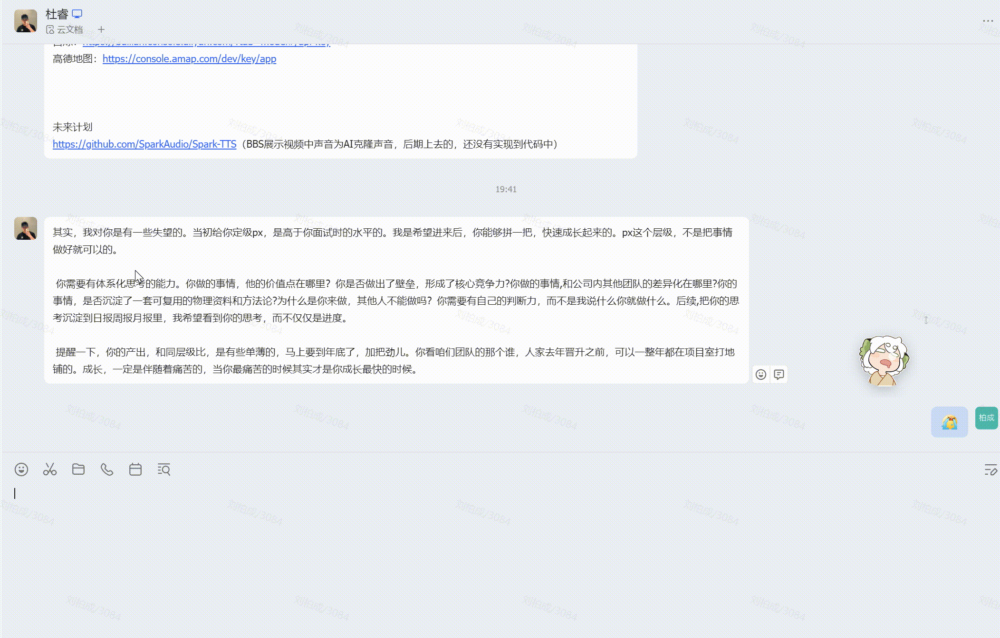
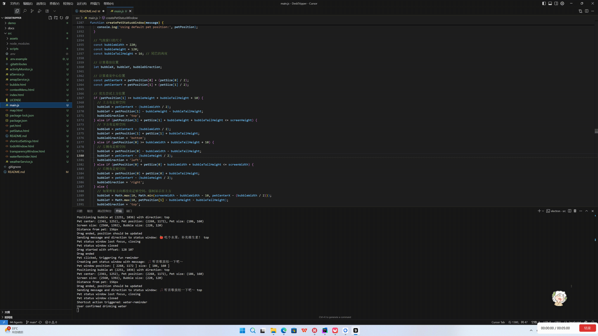
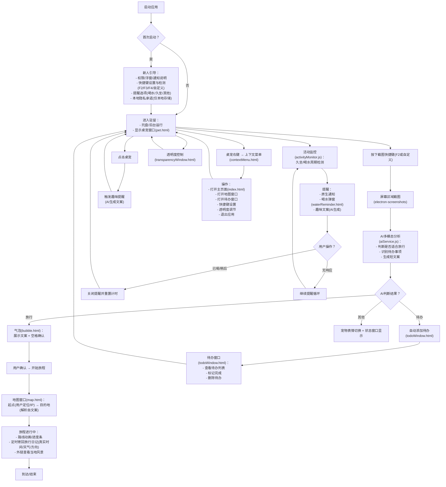

# HeiDeskCat：让小黑做你的上班搭子

> 内源平台讨论链接：[演示视频](<removed>)

如果你也相信 AI 不应该只有智商还应该有情商，或者单纯喜欢罗小黑一样可可爱爱的国漫 IP，请为我们点个 ⭐！

## 背景与用户洞察

1. **AI + 情绪陪伴的蓝海机会**  
   - 市面上 AI + 搜索/问答/工具 是红海，但 **AI + 情绪陪伴** 尚未被充分挖掘，参考[小红书独立开发大赛 2025](https://www.ifanr.com/1621805)。
   - [GPT-4o替代爹味GPT-5！奥特曼光速滑跪，OpenAI连夜回滚「赛博舔狗」](https://mp.weixin.qq.com/s/RXLQtu5MoPg4G82af4dVrg) - 用户反馈GPT-5情商不如4o，说明对"有情商"的AI陪伴类应用有强烈期待。  
   - 现有 AI 产品大多基于网页对话框（或语音接口），需要用户主动进入情境，缺乏 **桌面级、持续存在的视觉 AI 形态**。

2. **桌面宠物的空白**  
   - 虽有部分桌面宠物因"萌"出圈（如[捣蛋鹅](https://samperson.itch.io/desktop-goose)、[VPet](https://github.com/LorisYounger/VPet)、[Bongo Cat](https://mp.weixin.qq.com/s/1bVgHQXmTw5J9O9B3L6Bkg)），但缺乏"灵魂"，无法主动观察与情绪反馈；而大模型可赋予桌面宠物主动感知与情绪交互能力。

3. **国产 IP 产业的崛起**  
   - 从春节档《哪吒》到暑期档[《浪浪山小妖怪》](https://m.douban.com/movie/subject/36438475/)、[《罗小黑战记2》](https://movie.douban.com/subject/36448279/)，国产动漫 IP 热度持续攀升，二创不断，粉丝社群活跃。

## 用户故事

| 场景描述                                                                                                                        | 演示效果                     |
| ------------------------------------------------------------------------------------------------------------------------------- | ---------------------------- |
| **小馨（情绪陪伴+自动记待办）** <br/> 刚入职的新人，工作繁忙，渴望倾诉与情绪慰藉，同时希望AI能自动识别截图中的待办事项并记录。    |      |
| **小刚（健康提醒）** <br/> 工作狂，一坐一整天忘记喝水，期望桌面 AI 主动提醒健康习惯。                                             |  |
| **小牛（云旅行）** <br/> 热爱旅行，看到新闻上"这么近那么美周末到河北"，但工位限制了行动自由，希望感受"有人替他去旅行"的实时反馈。 |      |



## AI 赋能

| 阶段               | AI 角色      | 截屏                                     | 产出                                                                                                                                                       |
| ------------------ | ------------ | ---------------------------------------- | ---------------------------------------------------------------------------------------------------------------------------------------------------------- |
| 需求分析 | 产品（Kimi） |  | [产品需求文档 (PRD)](./docs/PRD.md) |
| 竞品调研   | 市场（GPT Research）    |      | [竞品调研报告](./docs/Research.docx)                                                                                                                                                       |
| MVP 实现 | 前端（通义灵码）     |    | [V1 文档/代码](./docs/V1.md)                                                                                                                                                       |
| 功能/UI 完善     | 前端（Cursor）     |    | [V2 文档/代码](./docs/V2.md)                                                                                                                                                       |

- cursor AI 对话记录：[杜睿](./docs/llm/20250812-cursor-du.md) 、[刘柏成1](./docs/llm/20250813-cursor-liu.md) 、[刘柏成2](./docs/llm/20250815-cursor-liu.md)
- AI 对话留痕（持续更新）：`./docs/llm`，`md`文件若大可能无法预览请下载查看。

## 运行指南

```bash
#进入项目目录
cd src

# 安装 Node.js 与 npm
npm install
npm start
```

参考 `.env.example`，配置：
- [阿里云百炼 API](https://bailian.console.aliyun.com/?tab=model#/api-key)（情绪陪伴功能）
- [高德地图 API](https://console.amap.com/dev/key/app)（云旅行功能）

## 未来计划

* 声音克隆（[SparkTTS](https://github.com/SparkAudio/Spark-TTS)）实现更拟人化的语音交互（BBS展示视频中声音为AI克隆声音，使用视频后期，计划中）
* 前端采用 three.js 打造更细致的视觉表现，增强 AI 情绪识别与多轮主动对话能力
* 桌面行为模式学习与个性化推荐
