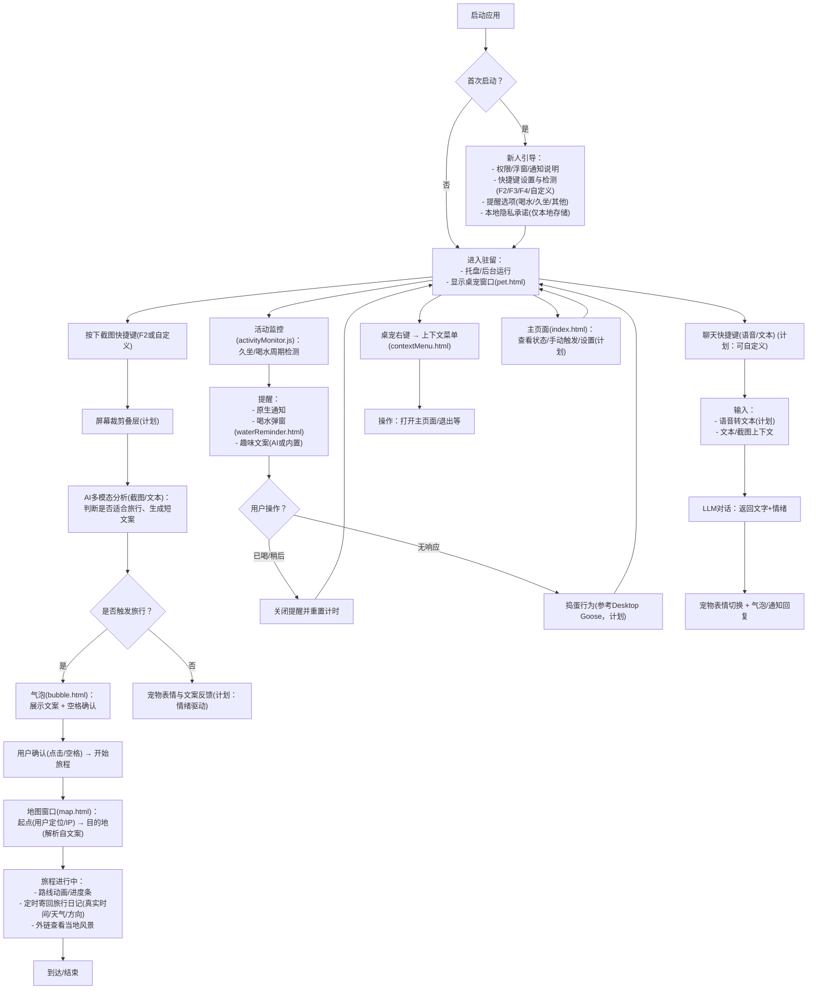

## 用户流程图

接下来可实现的增量点：
- 新人引导与本地设置存储：index.html 中加入 Onboarding 与快捷键检测、提醒开关持久化到 electron-store。
- 截图裁剪叠层与多模态识别：启用 desktopCapturer + 前端裁剪层，将裁剪区域传入 aiService.js。
- 旅行日记定时器：map.html 驱动回传「方向/速度/天气」到主进程，由主进程定时发通知，附上外链。
- 情绪驱动的宠物 UI：在 pet.html 中根据 LLM 返回情绪切换 GIF/表情。
- 自定义快捷键与冲突检测：设置页中写入 globalShortcut 动态注册前先检测占用，失败回退并提示。
- 数据与隐私：仅 electron-store 本地保存设置与非敏感状态；截图与语音内容仅在本地或直连模型，不落盘，不上传后端。